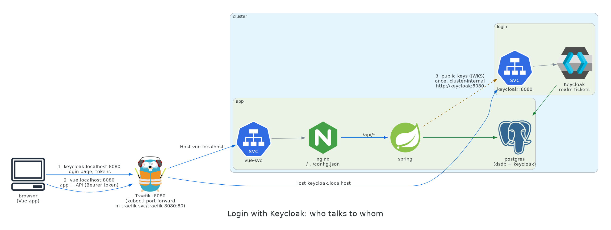

# Login with Keycloak

The Tickets app uses **[Keycloak](https://www.keycloak.org/)** for login. Before, the users and their passwords were hard-coded in the backend and every request carried them (HTTP Basic). Now:

- **Keycloak** owns the users, passwords and roles, and shows the login page.
- The **Vue frontend** sends the user to Keycloak to log in and gets back an **access token** (a signed JWT).
- The **Spring backend** never sees a password. It checks the token's signature and reads the user name and roles from it.

This file explains the whole setup and how the backend and frontend were changed. Keycloak's own manifests, the realm, the admin console and Keycloak troubleshooting are in **[keycloak/README.md](keycloak/README.md)**.

## Contents

1. [How it works](#1-how-it-works)
2. [Deploy](#2-deploy)
3. [Backend: an OAuth2 resource server](#3-backend-an-oauth2-resource-server)
4. [Frontend: keycloak-js](#4-frontend-keycloak-js)
5. [Try it](#5-try-it)
6. [Local development without Kubernetes](#6-local-development-without-kubernetes)
7. [Public HTTPS](#7-public-https)
8. [Troubleshooting](#8-troubleshooting)

---

## 1. How it works



| Component | Before | Now |
| --- | --- | --- |
| Users and passwords | in memory, in [SecurityConfig.java](backend/src/main/java/gr/hua/dit/tickets/config/SecurityConfig.java) | in Keycloak (realm `tickets`), stored in the shared `postgres-0` StatefulSet (`keycloak` database) |
| Login page | Vue form | Keycloak's login page |
| What each API call carries | `Authorization: Basic base64(alice:password)` | `Authorization: Bearer <access token>` |
| Backend checks | password against the in-memory list | token signature, issuer, expiry, audience |
| Roles `USER` / `AGENT` | in the backend | Keycloak client roles of `tickets-backend`, sent as the `roles` claim |

### The login flow: Authorization Code + PKCE


After the login, before every API call the app refreshes the access token with the refresh token if it expires within 30 s; no login page is shown.

- **PKCE** (Proof Key for Code Exchange): the app generates a random secret (`code_verifier`) and sends only its hash at step 1. At step 3 only the holder of the original secret can exchange the code for a token. This protects a **public client**, an app in the browser that cannot keep a client secret.
- The token is kept **in memory** by keycloak-js, not in `localStorage`, so other scripts on the page cannot read it later. After a page reload, keycloak-js asks Keycloak again (`check-sso`); the user is still logged in at Keycloak, so no password is needed.
- The backend is **stateless**: no session, no call to Keycloak per request. It downloads Keycloak's public keys once (step 6 of the flow, step 3 of the first diagram) and verifies every token locally.

### The access token

A JWT has three base64url parts, `header.payload.signature`. The payload for `alice` (abridged):

```json
{
  "iss": "http://keycloak.localhost:8080/realms/tickets",
  "aud": "tickets-backend",
  "azp": "tickets-frontend",
  "preferred_username": "alice",
  "roles": ["USER"],
  "exp": 1795530000
}
```

| Claim | Checked / used by the backend |
| --- | --- |
| signature | must verify with one of Keycloak's public keys (JWKS) |
| `exp` | the token must not be expired (5 minutes lifetime) |
| `iss` | must equal `KEYCLOAK_ISSUER_URI` **exactly** |
| `aud` | must contain `tickets-backend`. A token issued for another API is rejected |
| `preferred_username` | becomes the user name (`auth.getName()`), stored as `Ticket.createdBy` |
| `roles` | each entry becomes an authority `ROLE_<name>`, used by `@PreAuthorize("hasRole('USER')")` |

### Two names for one Keycloak: issuer vs. internal URL

The **browser** reaches Keycloak as `http://keycloak.localhost:8080` (through Traefik). The **backend** reaches it as `http://keycloak:8080` (the Service). Keycloak writes the URL it was called with into `iss`, so tokens say `http://keycloak.localhost:8080/realms/tickets`. The backend is therefore configured with **both**:

| Setting | Value | Used for |
| --- | --- | --- |
| `KEYCLOAK_ISSUER_URI` | `http://keycloak.localhost:8080/realms/tickets` | comparing with `iss` only, never called |
| `KEYCLOAK_JWK_SET_URI` | `http://keycloak:8080/realms/tickets/protocol/openid-connect/certs` | downloading the public keys |

### Why `*.localhost` host names

The login library (keycloak-js), and Keycloak's own admin console, use the browser's **Web Crypto API** (`crypto.randomUUID()`, `crypto.subtle` for PKCE). Browsers provide it only in a **[secure context](https://developer.mozilla.org/en-US/docs/Web/Security/Secure_Contexts)**: pages served over `https://`, or from `http://localhost` and `http://*.localhost`.

`http://vue.local:8080` is *not* a secure context, and logging in there fails with *"Web Crypto API is not available"*. So with Keycloak the app uses:

| Host | Ingress | Service |
| --- | --- | --- |
| `vue.localhost` | `vue-ingress` (now has two hosts: `vue.local` and `vue.localhost`) | `vue-svc` |
| `keycloak.localhost` | `keycloak-ingress` | `keycloak` |

Browsers (Chrome, Edge, Firefox) and `curl` resolve every `*.localhost` name to the loopback address on their own, where `kubectl port-forward -n traefik svc/traefik 8080:80` listens. No `/etc/hosts` entry is needed. On a public cluster, HTTPS provides the secure context instead ([section 7](#7-public-https)).

---

## 2. Deploy

Starting point: the app deployed as in the [main README](README.md#3-deploy-the-application) (postgres, spring, vue) and Traefik installed.

> **Fresh deploy:** `keycloak-secret.yaml` must be applied *before* `postgres/`, because the postgres StatefulSet reads the Keycloak database credentials from that Secret to run the init script. The main README's deploy order already reflects this.
>
> **Existing postgres (PVC already has data):** the init script only runs on a first (empty) start. Create the `keycloak` database manually: `kubectl exec -it postgres-0 -- psql -U dbuser -c "CREATE USER keycloak WITH PASSWORD 'keycloak-db-pass'; CREATE DATABASE keycloak OWNER keycloak;"`

### 2.1 Build images with the new code

The images `ghcr.io/tsadimas/cp-spring:keycloak` and `cp-vue:keycloak` must contain the Keycloak version of [backend/](backend/) and [frontend/](frontend/). If they were built before this change, rebuild and push them, or build them into minikube ([main README → Container registry](README.md#2-container-registry-github-packages)):

```bash
docker build -t ghcr.io/<GITHUB-USERNAME>/cp-spring:keycloak -f backend/Dockerfile.multistage  backend
docker build -t ghcr.io/<GITHUB-USERNAME>/cp-vue:keycloak    -f frontend/Dockerfile.multistage frontend
docker push ghcr.io/<GITHUB-USERNAME>/cp-spring:keycloak
docker push ghcr.io/<GITHUB-USERNAME>/cp-vue:keycloak
```

### 2.2 Keycloak

Details in [keycloak/README.md → Deploy](keycloak/README.md#deploy):

```bash
# Apply the secret first: the postgres init script reads the credentials from it
kubectl apply -f keycloak/keycloak-secret.yaml

kubectl create configmap keycloak-realm --from-file=keycloak/realm/tickets-realm.json
kubectl apply -f keycloak/keycloak-deployment.yaml -f keycloak/keycloak-svc.yaml -f keycloak/keycloak-ingress.yaml
kubectl rollout status deployment/keycloak --timeout=5m     # first start: 1-2 minutes
```

### 2.3 Backend and frontend

The manifests already contain the Keycloak settings ([section 3](#3-backend-an-oauth2-resource-server), [section 4](#4-frontend-keycloak-js)). Apply them again and restart, so the pods pull the new images:

```bash
kubectl apply -f spring/
kubectl apply -f vue/vue-deployment.yaml -f vue/vue-svc.yaml -f vue/vue-ingress.yaml
kubectl rollout restart deployment/spring-deployment deployment/vue-deployment
kubectl rollout status deployment/spring-deployment
```

Order does not matter much: Spring starts without Keycloak (it fetches the keys at the first request), and nginx does not contact Keycloak at all.

```bash
kubectl get pods            # keycloak, postgres-0, spring-…, vue-…  all Running 1/1
kubectl get ingress         # keycloak-ingress (keycloak.localhost), vue-ingress (vue.local, vue.localhost)
```

---

## 3. Backend: an OAuth2 resource server

In OAuth 2.0 terms the API is a **resource server**: it does not log anyone in, it only accepts requests that carry a valid access token.

| File | Change |
| --- | --- |
| [pom.xml](backend/pom.xml) | + `spring-boot-starter-security-oauth2-resource-server` (JWT decoding and validation, Nimbus JOSE) |
| [SecurityConfig.java](backend/src/main/java/gr/hua/dit/tickets/config/SecurityConfig.java) | `httpBasic()` and the in-memory users removed. `oauth2ResourceServer(jwt)` added, plus a `JwtAuthenticationConverter` that maps `preferred_username` → user name and `roles` → `ROLE_*` |
| [application.properties](backend/src/main/resources/application.properties) | `spring.security.oauth2.resourceserver.jwt.*`: issuer, JWKS URL, audience |
| [MeController.java](backend/src/main/java/gr/hua/dit/tickets/web/MeController.java) | returns only the `ROLE_*` authorities (Spring Security also adds e.g. `FACTOR_BEARER`) |
| [OpenApiConfig.java](backend/src/main/java/gr/hua/dit/tickets/config/OpenApiConfig.java) | Swagger *Authorize* asks for a Bearer token instead of a user/password |
| [TicketControllerTest.java](backend/src/test/java/gr/hua/dit/tickets/web/TicketControllerTest.java) | requests are authenticated with in-memory JWTs passed through the real converter; no Keycloak needed for `mvn test` |

The rest of the code did not change: `TicketService` still uses `auth.getName()` and the `ROLE_AGENT` authority, and the controllers still use `@PreAuthorize("hasRole('USER')")`. Only *where the user comes from* changed. Because the user name is still `alice` (not Keycloak's UUID in `sub`), the existing tickets in the database still belong to the same users.

### The security configuration

```java
http
    .authorizeHttpRequests(auth -> auth
        .requestMatchers("/actuator/health/**", "/actuator/info").permitAll()
        .requestMatchers("/swagger-ui.html", "/swagger-ui/**", "/v3/api-docs/**").permitAll()
        .requestMatchers("/api/**").authenticated()
        .anyRequest().denyAll())
    .oauth2ResourceServer(oauth2 -> oauth2
        .jwt(jwt -> jwt.jwtAuthenticationConverter(jwtAuthenticationConverter())));

@Bean
JwtAuthenticationConverter jwtAuthenticationConverter() {
    JwtGrantedAuthoritiesConverter roles = new JwtGrantedAuthoritiesConverter();
    roles.setAuthoritiesClaimName("roles");      // "roles": ["USER"]  →  ROLE_USER
    roles.setAuthorityPrefix("ROLE_");
    JwtAuthenticationConverter converter = new JwtAuthenticationConverter();
    converter.setJwtGrantedAuthoritiesConverter(roles);
    converter.setPrincipalClaimName("preferred_username");   // auth.getName() == "alice"
    return converter;
}
```

### Settings

[application.properties](backend/src/main/resources/application.properties) reads them from environment variables, like the database settings:

```properties
spring.security.oauth2.resourceserver.jwt.issuer-uri=${KEYCLOAK_ISSUER_URI:http://localhost:8180/realms/tickets}
spring.security.oauth2.resourceserver.jwt.jwk-set-uri=${KEYCLOAK_JWK_SET_URI:${spring.security.oauth2.resourceserver.jwt.issuer-uri}/protocol/openid-connect/certs}
spring.security.oauth2.resourceserver.jwt.audiences=${KEYCLOAK_AUDIENCE:tickets-backend}
```

| Variable | Default (local Docker Keycloak) | In [spring-deployment.yaml](spring/spring-deployment.yaml) |
| --- | --- | --- |
| `KEYCLOAK_ISSUER_URI` | `http://localhost:8180/realms/tickets` | `http://keycloak.localhost:8080/realms/tickets` (the browser's URL) |
| `KEYCLOAK_JWK_SET_URI` | issuer + `/protocol/openid-connect/certs` | `http://keycloak:8080/realms/tickets/protocol/openid-connect/certs` (the Service) |
| `KEYCLOAK_AUDIENCE` | `tickets-backend` | not set |

Because `jwk-set-uri` is set, Spring never calls the issuer URL (which would not resolve inside the cluster) and does not need Keycloak at startup.

### What the backend answers

| Request | Response |
| --- | --- |
| no `Authorization` header | `401`, `WWW-Authenticate: Bearer` |
| expired / tampered token, wrong `iss` or `aud` | `401`, `WWW-Authenticate: Bearer error="invalid_token", error_description="…"` (the reason) |
| valid token, wrong role (e.g. `agent` creates a ticket) | `403` |

---

## 4. Frontend: keycloak-js

| File | Change |
| --- | --- |
| [package.json](frontend/package.json) | + [`keycloak-js`](https://www.npmjs.com/package/keycloak-js), the official Keycloak adapter for browsers |
| [src/auth.js](frontend/src/auth.js) | **new**: loads `/config.json`, creates the Keycloak object, `initAuth()`, `login()`, `logout()`, `getToken()` |
| [src/api.js](frontend/src/api.js) | sends `Authorization: Bearer <token>`; asks `getToken()` before every call, so expiring tokens are refreshed |
| [src/App.vue](frontend/src/App.vue) | on start: `initAuth()`, then `GET /api/me`; *Log out* also ends the Keycloak session |
| [src/components/LoginForm.vue](frontend/src/components/LoginForm.vue) | the username/password form became a *Log in with Keycloak* button |
| [nginx/default.conf.template](frontend/nginx/default.conf.template), [Dockerfile.multistage](frontend/Dockerfile.multistage) | serve `/config.json` from `KEYCLOAK_*` environment variables |
| [vite.config.js](frontend/vite.config.js) | serves `/config.json` in `npm run dev` |

### The adapter

```js
// src/auth.js (simplified)
keycloak = new Keycloak({ url: config.keycloakUrl, realm: config.realm, clientId: config.clientId })
await keycloak.init({
  onLoad: 'check-sso',     // already logged in at Keycloak? come back with a token, otherwise stay anonymous
  pkceMethod: 'S256',
  checkLoginIframe: false, // the session-check iframe needs third-party cookies, which browsers block
})

export const login  = () => keycloak.login()                                         // → Keycloak login page
export const logout = () => keycloak.logout({ redirectUri: window.location.origin + '/' })
export async function getToken() { await keycloak.updateToken(30); return keycloak.token }
```

`/api/me` stays the source of the user name and roles that the UI shows, so the UI shows exactly what the backend understood from the token.

### Where is Keycloak? `/config.json`

The browser needs Keycloak's URL, but the frontend follows the rule "build once, configure at start-up" ([frontend/README.md](frontend/README.md#why-not-vite_api_url)). A `VITE_KEYCLOAK_URL` would be baked into the bundle at build time. Instead, the same nginx `envsubst` step that fills in `BACKEND_URL` renders a small JSON file:

```nginx
location = /config.json {
    default_type application/json;
    add_header   Cache-Control "no-store";
    return 200 '{"keycloakUrl":"${KEYCLOAK_URL}","realm":"${KEYCLOAK_REALM}","clientId":"${KEYCLOAK_CLIENT_ID}"}';
}
```

| Variable | Image default ([Dockerfile](frontend/Dockerfile.multistage)) | In [vue-deployment.yaml](vue/vue-deployment.yaml) | `npm run dev` default |
| --- | --- | --- | --- |
| `KEYCLOAK_URL` | `http://keycloak.localhost:8080` | `http://keycloak.localhost:8080` | `http://localhost:8180` |
| `KEYCLOAK_REALM` | `tickets` | `tickets` | `tickets` |
| `KEYCLOAK_CLIENT_ID` | `tickets-frontend` | `tickets-frontend` | `tickets-frontend` |

```bash
curl -s http://vue.localhost:8080/config.json
# {"keycloakUrl":"http://keycloak.localhost:8080","realm":"tickets","clientId":"tickets-frontend"}
```

These values are public: anyone can read them in the browser. A public client has no secret to hide.

---

## 5. Try it

Start the Traefik port-forward and keep it running:

```bash
kubectl port-forward -n traefik svc/traefik 8080:80
```

### In the browser

1. Open <http://vue.localhost:8080> and click **Log in with Keycloak**.
2. Keycloak's login page opens at `keycloak.localhost:8080`. Log in as `alice` / `password`.
3. You are back in the app as **alice (USER)**. Create a ticket.
4. **Log out**, then log in as `agent` / `password`: you see all tickets and can assign and resolve them.

Watch it in the browser's developer tools (*Network* tab): the redirect to `/auth` with `code_challenge`, the `POST /token`, and the `Authorization: Bearer …` header on the `/api/...` calls.

> **Codespaces:** the browser flow does not work through a Codespaces forwarded URL: it has a different host name and the Keycloak URL in `/config.json` points to `keycloak.localhost`. Use `curl` in the Codespace terminal, as below.

### With curl

The client `tickets-cli` allows the **password grant**, which exchanges a user name and password directly for a token. It is meant for testing only:

```bash
TOKEN=$(curl -s http://keycloak.localhost:8080/realms/tickets/protocol/openid-connect/token \
  -d grant_type=password -d client_id=tickets-cli -d username=alice -d password=password | jq -r .access_token)

curl -H "Authorization: Bearer $TOKEN" http://vue.localhost:8080/api/me        # {"username":"alice","roles":["USER"]}
curl -H "Authorization: Bearer $TOKEN" http://vue.localhost:8080/api/tickets

curl -H "Authorization: Bearer $TOKEN" -H 'Content-Type: application/json' \
  -d '{"title":"Laptop is slow","priority":"HIGH"}' http://vue.localhost:8080/api/tickets

curl -i http://vue.localhost:8080/api/me                                       # 401, WWW-Authenticate: Bearer
```

A small helper for several users:

```bash
token() { curl -s http://keycloak.localhost:8080/realms/tickets/protocol/openid-connect/token \
  -d grant_type=password -d client_id=tickets-cli -d username=$1 -d password=password | jq -r .access_token; }

curl -H "Authorization: Bearer $(token agent)" http://vue.localhost:8080/api/tickets
curl -H "Authorization: Bearer $(token agent)" -X POST http://vue.localhost:8080/api/tickets/1/assign
```

Tokens expire after **5 minutes**; get a new one when you see `401` with `Jwt expired`.

**See the issuer check in action:** a token requested through a different URL has a different `iss`, and the backend rejects it:

```bash
kubectl port-forward svc/keycloak 8180:8080      # second terminal: Keycloak directly, bypassing Traefik
BAD=$(curl -s http://localhost:8180/realms/tickets/protocol/openid-connect/token \
  -d grant_type=password -d client_id=tickets-cli -d username=alice -d password=password | jq -r .access_token)
curl -si -H "Authorization: Bearer $BAD" http://vue.localhost:8080/api/me | grep -i www-authenticate
# WWW-Authenticate: Bearer error="invalid_token", error_description="… The iss claim is not valid" …
```

### Swagger UI

```bash
kubectl port-forward svc/spring 8081:8080       # 8080 is used by the Traefik port-forward
```

Open <http://localhost:8081/swagger-ui.html>, click **Authorize**, paste a token (`echo $TOKEN`) and try the endpoints.

---

## 6. Local development without Kubernetes

### Everything with Docker Compose

[compose.yaml](compose.yaml) in the root folder starts the whole app with the same layout as the Kubernetes manifests: `db`, `backend`, `frontend`, `keycloak` (production mode) and `keycloak-db`.

```bash
docker compose up --build -d
docker compose ps            # wait until all are "healthy" (Keycloak: ~1 minute the first time)
```

| URL | What |
| --- | --- |
| <http://localhost:8081> | the app: *Log in with Keycloak*, `alice` / `bob` / `agent`, password `password` |
| <http://localhost:8180/admin> | Keycloak admin console, `admin` / `admin` |
| <http://localhost:8080/swagger-ui.html> | Swagger UI of the backend |

The browser uses `localhost` URLs, which are a secure context. The containers reach each other by service name. As in Kubernetes, the backend has two Keycloak settings: `KEYCLOAK_ISSUER_URI=http://localhost:8180/realms/tickets` (what the browser sees, compared with `iss`) and `KEYCLOAK_JWK_SET_URI=http://keycloak:8080/...` (inside the backend container, `localhost` is the container itself). A token from the command line:

```bash
TOKEN=$(curl -s http://localhost:8180/realms/tickets/protocol/openid-connect/token \
  -d grant_type=password -d client_id=tickets-cli -d username=alice -d password=password | jq -r .access_token)
curl -H "Authorization: Bearer $TOKEN" http://localhost:8081/api/me
```

`docker compose down` stops everything and keeps the data in the volumes. `docker compose down -v` also deletes the volumes, so the realm is imported again on the next start.

> Right after the first start, Keycloak reports healthy a few seconds before it has finished importing the realm; requests in that window get `503`. Just retry.

### Only Keycloak in Docker, the apps from source

Run Keycloak with Docker on port **8180** in development mode (`start-dev`: in-memory database, realm imported from the JSON file on every start):

```bash
docker run -d --name keycloak -p 8180:8080 \
  -e KC_BOOTSTRAP_ADMIN_USERNAME=admin -e KC_BOOTSTRAP_ADMIN_PASSWORD=admin \
  -v "$PWD/keycloak/realm:/opt/keycloak/data/import:ro" \
  quay.io/keycloak/keycloak:26.8.2 start-dev --import-realm
```

The defaults of both apps point to it, so nothing needs to be configured:

```bash
(cd backend  && mvn spring-boot:run)     # issuer http://localhost:8180/realms/tickets, needs Postgres (backend/README.md)
(cd frontend && npm run dev)             # http://localhost:5173, /config.json → http://localhost:8180
```

Open <http://localhost:5173>: `http://localhost:5173/*` is a valid redirect URI of `tickets-frontend`, and `localhost` is a secure context. The admin console is at <http://localhost:8180/admin>.

---

## 7. Public HTTPS

On a cluster reachable from the internet ([cert/README.md](cert/README.md)), Keycloak gets its own public name and certificate. Over HTTPS the browser has a secure context, so any host name works.

1. Create a DNS record for Keycloak (e.g. `keycloak.tsadimas.dns-cloud.net`) pointing at Traefik, set it in [keycloak-ingress-letsencrypt.yaml](keycloak/keycloak-ingress-letsencrypt.yaml) and apply it (after `vue/vue-ingress-letsencrypt.yaml`). See [keycloak/README.md → Public HTTPS](keycloak/README.md#public-https).
2. Point the apps at the public Keycloak URL — apply the letsencrypt deployment variants (they set `KEYCLOAK_ISSUER_URI` and `KEYCLOAK_URL` to the public HTTPS host):

   ```bash
   kubectl apply -f spring/spring-deployment-letsencrypt.yaml
   kubectl apply -f vue/vue-deployment-letsencrypt.yaml
   ```

   `KEYCLOAK_JWK_SET_URI` stays internal (Spring fetches signing keys pod-to-pod).
3. The frontend's public URL `https://tickets.tsadimas.dns-cloud.net/*` is already a valid redirect URI in [tickets-realm.json](keycloak/realm/tickets-realm.json). For another name, add it in the admin console (*Clients* → `tickets-frontend` → *Valid redirect URIs*).
4. Change the admin password and the demo users' passwords: the instance is now on the internet.

---

## 8. Troubleshooting

Start with the browser's developer tools (*Console* and *Network*), `kubectl logs deploy/spring-deployment` and `kubectl logs deploy/keycloak`.

| Symptom | Likely cause |
| --- | --- |
| *"Web Crypto API is not available"* (browser console or Keycloak page) | not a secure context: you opened `http://vue.local:8080` or an IP address. Use `http://vue.localhost:8080` |
| App shows *"Keycloak not reachable"*, or the browser cannot open `keycloak.localhost` | Keycloak not running/ready (`kubectl get pods -l app=keycloak`), Traefik port-forward not running, or `KEYCLOAK_URL` wrong (`curl -s http://vue.localhost:8080/config.json`) |
| Keycloak: *"Invalid parameter: redirect_uri"* | the app's URL (including the port) is not in *Valid redirect URIs* of `tickets-frontend` |
| Keycloak: *"Client not found"* | `KEYCLOAK_CLIENT_ID` / `KEYCLOAK_REALM` wrong, or the realm was not imported (`kubectl logs deploy/keycloak \| grep imported`) |
| App: *"Logged in at Keycloak, but the API rejected the token (401)"* | the token's `iss` does not equal `KEYCLOAK_ISSUER_URI`. Typical: a different port or host in the browser than in the backend's setting. Spring explains the reason in the `WWW-Authenticate` header of the `401` (*Network* tab) |
| `401` … `The aud claim is not valid` | the client has no audience mapper for `tickets-backend` (e.g. a new client created in the console) |
| Logged in, but every action gives `403` | the user has no client role `USER` / `AGENT` of `tickets-backend`. Assign it in the console ([keycloak/README.md → Admin console](keycloak/README.md#admin-console)) |
| `401` … `Jwt expired` with curl | tokens live 5 minutes. Get a new one |
| `401` … `An error occurred while attempting to decode the Jwt` / connection refused in the Spring log | Spring cannot download the keys: check `KEYCLOAK_JWK_SET_URI` and `kubectl get endpoints keycloak` |
| `docker compose up`: `port is already allocated` | 8080, 8081 or 8180 is used by another program. Change the left side of `ports:` in [compose.yaml](compose.yaml); for the frontend or Keycloak also change `KEYCLOAK_URL` / `KEYCLOAK_ISSUER_URI` and the redirect URIs to the new port |
| Old login form with username/password still shown | the pods run the old images: rebuild and push ([2.1](#21-build-images-with-the-new-code)), then `kubectl rollout restart` |

## Links

- [OAuth 2.0 for browser-based apps (IETF draft)](https://datatracker.ietf.org/doc/html/draft-ietf-oauth-browser-based-apps)
- [PKCE, RFC 7636](https://datatracker.ietf.org/doc/html/rfc7636)
- [Keycloak JavaScript adapter (keycloak-js)](https://www.keycloak.org/securing-apps/javascript-adapter)
- [Spring Security: OAuth 2.0 Resource Server, JWT](https://docs.spring.io/spring-security/reference/servlet/oauth2/resource-server/jwt.html)
- [jwt.io](https://jwt.io): decode a JWT in the browser
