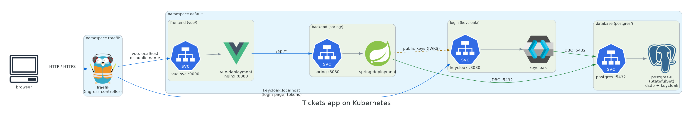

# Kubernetes Playground

Hands-on Kubernetes manifests for a three-tier application — **PostgreSQL**, a **Spring Boot** backend and a **Vue** frontend — running on [minikube](https://minikube.sigs.k8s.io/) (or [MicroK8s](MICROK8S.md)).

The application is a small **ticketing system** (from the [docker-playground](https://github.com/tsadimasteaching/docker-playground/tree/docker) repository). Its source and Dockerfiles are in [backend/](backend/README.md) and [frontend/](frontend/README.md). Users log in through **[Keycloak](Keycloak.md)**. Demo users, all with password `password`: `alice` and `bob` (role USER: create and edit their own tickets), `agent` (role AGENT: see, assign and resolve all tickets).



The frontend and Keycloak have an Ingress. The backend is reached through the frontend's nginx (`/api/*`), never directly from outside the cluster. How the login works is explained in **[Keycloak.md](Keycloak.md)**.

## Repository structure

```text
.
├── .devcontainer/      # Dev container / GitHub Codespaces setup
├── backend/            # Spring Boot source + Dockerfile — see backend/README.md
├── frontend/           # Vue source + Dockerfile + nginx config — see frontend/README.md
├── cert/               # cert-manager + Let's Encrypt ClusterIssuer — see cert/README.md
├── docs/               # Architecture diagrams (generated with icons from docs/diagrams/) — see docs/diagrams/README.md
├── keycloak/           # Keycloak (login), its PostgreSQL and the realm "tickets" — see keycloak/README.md
├── postgres/           # StatefulSet and Services for PostgreSQL — see postgres/README.md
├── spring/             # Spring Boot Deployment and Service (no Ingress) — see spring/README.md
├── vue/                # Vue frontend Deployment, Service, Ingresses (vue.local[host], public HTTPS) — see vue/README.md
├── compose.yaml        # The whole app with Docker Compose (no Kubernetes) — see Keycloak.md section 6
├── Keycloak.md         # How login with Keycloak works, and how backend and frontend use it
└── MICROK8S.md         # Alternative setup: running the playground on MicroK8s
```

> **Without Kubernetes:** `docker compose up --build -d` starts the whole app (PostgreSQL, Spring, Vue, Keycloak) from [compose.yaml](compose.yaml). Open <http://localhost:8081>. See [Keycloak.md → Docker Compose](Keycloak.md#everything-with-docker-compose).

## Contents

1. [Environment setup](#1-environment-setup)
2. [Container registry (GitHub Packages)](#2-container-registry-github-packages)
3. [Deploy the application](#3-deploy-the-application)
4. [Access the application](#4-access-the-application)
5. [Public HTTPS with Let's Encrypt](#5-public-https-with-lets-encrypt)
6. [Useful tools](#6-useful-tools)

---

## 1. Environment setup

### Option A — Dev container / Codespaces (recommended)

Open the repository in GitHub Codespaces or in VS Code with *Dev Containers: Reopen in Container*. The container:

- is based on **Ubuntu 24.04** (`devcontainers/base:ubuntu-24.04`) and installs `docker` (docker-in-docker), `kubectl` 1.37, `helm` and `minikube` via devcontainer features
- installs `k9s`, `kustomize` and `fzf` ([startup_script.sh](.devcontainer/startup_script.sh))
- on every container start, once Docker is ready, starts minikube (Kubernetes v1.37.0), makes sure minikube's NGINX ingress addon is disabled and installs the Traefik ingress controller with Helm ([start_minikube.sh](.devcontainer/start_minikube.sh)). If the cluster is not up, check the log with *Codespaces: View Creation Log* or run `bash .devcontainer/start_minikube.sh`
- adds these shell aliases:

| Alias | Command |
| --- | --- |
| `k` | `kubectl` |
| `kg` | `kubectl get` |
| `kd` | `kubectl describe` |
| `kdel` | `kubectl delete` |
| `kga` | `kubectl get all` |
| `kgn` | `kubectl get all --all-namespaces` |

> The container needs at least 4 CPUs, 8 GB RAM and 32 GB disk.

### Option B — Local machine

Install [docker](https://docs.docker.com/get-docker/), [kubectl](https://kubernetes.io/docs/tasks/tools/), [minikube](https://minikube.sigs.k8s.io/docs/start/) and [helm](https://helm.sh/docs/intro/install/):

```bash
curl -fsSL -o get_helm.sh https://raw.githubusercontent.com/helm/helm/main/scripts/get-helm-3
chmod 700 get_helm.sh
./get_helm.sh
```

Then start minikube:

```bash
minikube start --kubernetes-version=v1.37.0
```

### Option C — MicroK8s

On a Linux machine or VM you can use [MicroK8s](https://microk8s.io/) instead of minikube. Installation, the required addons (`dns`, `hostpath-storage`), Traefik and how to reach it without `minikube tunnel` are described in **[MICROK8S.md](MICROK8S.md)**.

### Install the Traefik ingress controller

An `Ingress` is only a set of routing rules. An **ingress controller** reads those rules and actually serves the traffic. This repository uses [Traefik](https://doc.traefik.io/traefik/), and every Ingress here sets `ingressClassName: traefik`.

In the dev container Traefik is installed automatically. On a local machine:

```bash
helm repo add traefik https://traefik.github.io/charts --force-update

helm upgrade --install traefik traefik/traefik \
  --namespace traefik \
  --create-namespace \
  --wait
```

Verify:

```bash
kubectl get pods -n traefik          # traefik-xxxxx   1/1   Running
kubectl get ingressclass             # traefik   traefik.io/ingress-controller
kubectl get svc -n traefik traefik   # type LoadBalancer, ports 80 and 443
```

The chart's defaults are enough here:

| Default | Meaning |
| --- | --- |
| IngressClass `traefik`, marked as default | Ingresses with `ingressClassName: traefik`, or with no class at all, are served by Traefik |
| entrypoint `web` → port 80 | HTTP. Selected with the annotation `traefik.ingress.kubernetes.io/router.entrypoints: web` |
| entrypoint `websecure` → port 443 | HTTPS. Selected with `router.entrypoints: websecure` and `router.tls: "true"` |
| Service type `LoadBalancer` | on minikube it gets an external IP only while `minikube tunnel` runs (see [section 4](#4-access-the-application)) |

> Use only **one** ingress controller. If you enabled the NGINX addon earlier (`minikube addons enable ingress`), disable it. Otherwise two controllers compete for the same Ingresses. The dev container does this automatically. On a local machine:
>
> ```bash
> minikube addons disable ingress
> ```
>
> To re-run the dev container's setup by hand (start minikube, disable NGINX, install Traefik): `bash .devcontainer/start_minikube.sh`.

To remove Traefik: `helm uninstall traefik -n traefik`.

---

## 2. Container registry (GitHub Packages)

The Spring and Vue images are pulled from `ghcr.io`. If the images are private (or you push your own), the cluster needs credentials.

### Create a personal access token

1. GitHub → *Settings* → *Developer settings* → *Personal access tokens* → *Tokens (classic)*
2. Select the scopes:
   - `read:packages` — enough to **pull** images
   - `write:packages` — needed to **push** images
3. Save the token to a file, e.g. `~/github-image-repo.txt`

Your packages are listed under the *Packages* tab of your GitHub profile.

### Images used by the manifests

| Deployment | Image | Built from |
| --- | --- | --- |
| `spring-deployment` | `ghcr.io/tsadimas/cp-spring:keycloak` | [backend/Dockerfile.multistage](backend/Dockerfile.multistage) |
| `vue-deployment` | `ghcr.io/tsadimas/cp-vue:keycloak` | [frontend/Dockerfile.multistage](frontend/Dockerfile.multistage) |

> New GitHub packages are **private** by default. Either make them public (package → *Package settings* → *Change visibility*) or create the `registry-credentials` secret below.

### Build and push an image yourself

To use your own fork or registry account, build from the repository root and change the `image:` in the Deployments:

```bash
# build and tag
docker build -t ghcr.io/<GITHUB-USERNAME>/cp-spring:keycloak -f backend/Dockerfile.multistage  backend
docker build -t ghcr.io/<GITHUB-USERNAME>/cp-vue:keycloak    -f frontend/Dockerfile.multistage frontend

# log in to the registry
cat ~/github-image-repo.txt | docker login ghcr.io -u <GITHUB-USERNAME> --password-stdin

# push
docker push ghcr.io/<GITHUB-USERNAME>/cp-spring:keycloak
docker push ghcr.io/<GITHUB-USERNAME>/cp-vue:keycloak
```

### Without a registry (minikube)

Build straight into minikube's image store. After deploying the app ([section 3](#3-deploy-the-application)), point the Deployments at the local tag. Use a tag other than `latest`, because for `latest` Kubernetes always tries to pull from the registry:

```bash
(cd backend  && minikube image build -t tickets-backend:dev  -f Dockerfile.multistage .)
(cd frontend && minikube image build -t tickets-frontend:dev -f Dockerfile.multistage .)

kubectl set image deployment/spring-deployment spring=tickets-backend:dev
kubectl set image deployment/vue-deployment    vue=tickets-frontend:dev
```

> `kubectl apply -f spring/` or `-f vue/vue-deployment.yaml` sets the image back to the ghcr.io one. To keep the local image, change `image:` in the YAML instead.

On MicroK8s, see the *Local images* row in [MICROK8S.md](MICROK8S.md#6-differences-from-minikube).

### Create the image pull secret

The Spring and Vue Deployments reference a secret named `registry-credentials` via `imagePullSecrets`.

**Quick way** — let `kubectl` build it:

```bash
kubectl create secret docker-registry registry-credentials \
  --docker-server=ghcr.io \
  --docker-username=<GITHUB-USERNAME> \
  --docker-password="$(cat ~/github-image-repo.txt)"
```

**Manual way** — useful to understand what is stored in the secret. Create a file named `.dockerconfig.json` (it is git-ignored):

```json
{
  "auths": {
    "https://ghcr.io": {
      "username": "REGISTRY_USERNAME",
      "password": "REGISTRY_TOKEN",
      "email": "REGISTRY_EMAIL",
      "auth": "BASE_64_BASIC_AUTH_CREDENTIALS"
    }
  }
}
```

Generate `BASE_64_BASIC_AUTH_CREDENTIALS` with:

```bash
echo -n <USER>:<TOKEN> | base64
```

and create the secret from the file:

```bash
kubectl create secret docker-registry registry-credentials --from-file=.dockerconfigjson=.dockerconfig.json
```

---

## 3. Deploy the application

Apply the tiers in order. The Keycloak secret must come first because the postgres StatefulSet reads the Keycloak database credentials from it via `secretKeyRef`:

```bash
# 1. Keycloak credentials — must exist before postgres starts (StatefulSet references keycloak-secrets)
kubectl apply -f keycloak/keycloak-secret.yaml

# 2. Database — init script creates both "dsdb" (app) and "keycloak" databases on first start
kubectl apply -f postgres/
kubectl rollout status statefulset/postgres   # wait until postgres-0 is Ready

# 3. Backend and frontend
kubectl apply -f spring/
kubectl apply -f vue/vue-deployment.yaml -f vue/vue-svc.yaml -f vue/vue-ingress.yaml

# 4. Keycloak — details in Keycloak.md → Deploy
kubectl create configmap keycloak-realm --from-file=keycloak/realm/tickets-realm.json
kubectl apply -f keycloak/keycloak-deployment.yaml -f keycloak/keycloak-svc.yaml -f keycloak/keycloak-ingress.yaml
kubectl rollout status deployment/keycloak --timeout=5m     # first start: 1-2 minutes
```

> `vue/vue-ingress-letsencrypt.yaml` is for a cluster with a public DNS name only, see [section 5](#5-public-https-with-lets-encrypt).

Check that everything is up:

```bash
kubectl get all
kubectl get ingress
kubectl logs deploy/spring-deployment
```

The Spring pod becomes *Ready* only once its readiness probe (`/actuator/health/readiness`) succeeds, which can take a minute.

> **Note:** the database credentials are written in plain text in the manifests to keep the example simple. In a real deployment, store them in a `Secret` and reference them with `valueFrom.secretKeyRef`.

### Per-component details

Each directory has its own README with prerequisites, testing and troubleshooting:

| Component | README | Highlights |
| --- | --- | --- |
| PostgreSQL | [postgres/README.md](postgres/README.md) | why it runs as a **StatefulSet**, connecting with `psql`, data persistence |
| Keycloak | [keycloak/README.md](keycloak/README.md) | production mode, the realm `tickets` (clients, roles, users), admin console |
| Spring backend | [spring/README.md](spring/README.md) | configuration, probes, checking the database connection, Swagger UI |
| Vue frontend | [vue/README.md](vue/README.md) | nginx `/api` proxy, how the **Ingress** works, testing with and without Traefik |
| TLS | [cert/README.md](cert/README.md) | cert-manager and Let's Encrypt step by step, HTTP → HTTPS redirect |

---

## 4. Access the application

Traefik routes requests by **hostname**:

| Host | Ingress | Service |
| --- | --- | --- |
| `vue.localhost` (use this in the browser) or `vue.local` | `vue-ingress` (HTTP) | `vue-svc` (port 9000) |
| `keycloak.localhost` | `keycloak-ingress` (HTTP) | `keycloak` (port 8080) |
| public name, e.g. `tickets.tsadimas.dns-cloud.net` | `vue-ingress-letsencrypt` (HTTPS + redirect) | `vue-svc` (port 9000) |

The API is under the same host (`/api/...`). Spring has no Ingress of its own.

### Option A — Port-forward to Traefik (works everywhere, including Codespaces)

```bash
kubectl port-forward -n traefik svc/traefik 8080:80 8443:443
```

In a second terminal, send requests through Traefik. `curl` and browsers resolve `*.localhost` names to 127.0.0.1 by themselves, so no `/etc/hosts` entry is needed:

```bash
curl http://vue.localhost:8080/

# get a token from Keycloak, then call the API: frontend nginx → spring → postgres
TOKEN=$(curl -s http://keycloak.localhost:8080/realms/tickets/protocol/openid-connect/token \
  -d grant_type=password -d client_id=tickets-cli -d username=alice -d password=password | jq -r .access_token)
curl -H "Authorization: Bearer $TOKEN" http://vue.localhost:8080/api/me
```

On a local machine open <http://vue.localhost:8080> in the browser, click *Log in with Keycloak* and log in as `alice`, `bob` or `agent` (password `password`). Use `vue.localhost`, not `vue.local`: the login needs a [secure context](Keycloak.md#why-localhost-host-names).

> In Codespaces, the forwarded URL (`https://<name>-8080.app.github.dev`) sends a different `Host` header, so Traefik's host rules do not match. Test from the Codespace terminal with `curl` as above, or use Option C.

### Option B — `minikube tunnel` (local machine, standard ports)

```bash
minikube tunnel                       # keep it running in its own terminal
kubectl get svc -n traefik traefik    # note the EXTERNAL-IP
echo "<EXTERNAL-IP> vue.local" | sudo tee -a /etc/hosts
curl -si http://vue.local/api/me | head -1     # 401 + WWW-Authenticate: Bearer = Spring answered
```

> The Keycloak setup expects the browser at `vue.localhost:8080` / `keycloak.localhost:8080` (Option A). With another host or port, change `KEYCLOAK_URL`, `KEYCLOAK_ISSUER_URI` and the redirect URIs as described in [Keycloak.md](Keycloak.md#two-names-for-one-keycloak-issuer-vs-internal-url).

### Option C — Without an Ingress

Port-forward directly to the Services, bypassing Traefik. Each command keeps running, so use a separate terminal for each, and stop the Traefik port-forward first because it also uses 8080:

```bash
kubectl port-forward svc/spring 8080:8080      # terminal 1 → http://localhost:8080/swagger-ui.html
kubectl port-forward svc/vue-svc 9000:9000     # terminal 2 → http://localhost:9000/
```

---

## 5. Public HTTPS with Let's Encrypt

On a cluster reachable from the internet (e.g. the MicroK8s cloud VM of [MICROK8S.md](MICROK8S.md)), the frontend gets a public name and a browser-trusted certificate. The step-by-step guide is in **[cert/README.md](cert/README.md)**: DNS and firewall requirements, installing cert-manager, the ClusterIssuer, the HTTP-01 challenge, the HTTP → HTTPS redirect and troubleshooting. In short:

```bash
helm repo add jetstack https://charts.jetstack.io --force-update
helm install cert-manager jetstack/cert-manager \
  --namespace cert-manager --create-namespace \
  --version v1.21.3 --set crds.enabled=true

kubectl apply -f cert/letsencrypt-prod-issuer.yaml                  # ClusterIssuer letsencrypt-prod
kubectl apply -f vue/vue-ingress-letsencrypt.yaml                   # set your host name in it first
kubectl apply -f keycloak/keycloak-ingress-letsencrypt.yaml         # Keycloak public HTTPS
kubectl apply -f spring/spring-deployment-letsencrypt.yaml          # KEYCLOAK_ISSUER_URI → public URL
kubectl apply -f vue/vue-deployment-letsencrypt.yaml                # KEYCLOAK_URL → public URL
kubectl get certificate                                             # vue-letsencrypt-tls + keycloak-letsencrypt-tls → READY True

curl -I https://tickets.tsadimas.dns-cloud.net/            # 200, no -k needed
curl -s -o /dev/null -w '%{http_code} %{redirect_url}\n' http://tickets.tsadimas.dns-cloud.net/   # 301 https://...
```

> Not on minikube or Codespaces: Let's Encrypt must reach Traefik from the internet on port 80. Use `vue.local` there.

---

## 6. Useful tools

Tools that make working with a cluster easier than plain `kubectl`. All of them read your kubeconfig (`~/.kube/config`), so they work with minikube out of the box. Tools marked with ✅ are already installed in the dev container.

### Terminal

| Tool | What it does | Install / run |
| --- | --- | --- |
| [k9s](https://k9scli.io/) ✅ | Full-screen terminal UI: browse resources, view logs, exec into pods, port-forward, edit and delete — all with keyboard shortcuts | `k9s` (`:pods`, `:svc`, `:deploy`, `?` for help) |
| [k10s](https://github.com/p10node/k10s) | k9s-inspired terminal UI with mouse support, on-screen action hints and instant search (`ctrl+p`); optional AI assistant with your own API key. New project | `go install github.com/p10node/k10s@latest` |
| [sofka](https://github.com/nklmilojevic/sofka) | Rust terminal UI, a reimagining of k9s: bulk actions, background port-forwards, read-only mode, Helm inspector, Flux / Argo CD views. New project | `cargo install sofka` or prebuilt binary from GitHub releases |
| [kubectx / kubens](https://github.com/ahmetb/kubectx) | Switch quickly between clusters (contexts) and namespaces | `kubectx minikube`, `kubens kube-system` |
| [stern](https://github.com/stern/stern) | Tail logs from many pods at once, color-coded per pod | `stern spring` |
| [krew](https://krew.sigs.k8s.io/) | Plugin manager for `kubectl` | `kubectl krew install <plugin>` |
| [kube-ps1](https://github.com/jonmosco/kube-ps1) | Shows the current context and namespace in the shell prompt — helps avoid running commands against the wrong cluster | add to `~/.bashrc` |
| [fzf](https://github.com/junegunn/fzf) ✅ | Fuzzy finder; makes `kubectx` / `kubens` interactive | — |

### Graphical / web UIs

| Tool | What it does | Install / run |
| --- | --- | --- |
| [Headlamp](https://headlamp.dev/) | Open-source Kubernetes UI from Kubernetes SIG UI; desktop app or in-cluster web app, extensible with plugins | desktop app, or Helm chart in the cluster |
| [Radar](https://github.com/skyhook-io/radar) | Open-source web UI with a topology view, event timeline, resource browser, Helm and GitOps (Argo CD / Flux) views | `kubectl krew install radar` then `kubectl radar` (opens <http://localhost:9280>) |
| [Lens](https://k8slens.dev/) | Popular desktop IDE for Kubernetes; free for personal and education use, paid subscription for commercial use | desktop app |
| [Freelens](https://freelens.app/) | Free, open-source fork of Lens | desktop app |
| [Kubernetes Dashboard](https://github.com/kubernetes/dashboard) | The former official web UI, **archived** in January 2026 (Headlamp is its successor). Still shipped as a minikube addon | `minikube dashboard` (in Codespaces: `minikube dashboard --url`) |

> Desktop apps (Headlamp, Lens, Freelens) run on your own machine, so they cannot see a minikube cluster that lives inside a Codespace. There, prefer the terminal tools, Radar or `minikube dashboard` — Codespaces forwards their ports to the browser.

---

## Links

- [Traefik: install with Helm](https://doc.traefik.io/traefik/getting-started/install-traefik/)
- [Traefik: Kubernetes Ingress provider and annotations](https://doc.traefik.io/traefik/providers/kubernetes-ingress/)
- [cert-manager installation with Helm](https://cert-manager.io/docs/installation/helm/)
- [Troubleshooting cert-manager](https://cert-manager.io/docs/troubleshooting/)
- [Pull an image from a private registry](https://kubernetes.io/docs/tasks/configure-pod-container/pull-image-private-registry/)
- [StatefulSets](https://kubernetes.io/docs/concepts/workloads/controllers/statefulset/)
- [Spring Boot health probes](https://www.baeldung.com/spring-liveness-readiness-probes)
- [Keycloak: running in a container](https://www.keycloak.org/server/containers)
