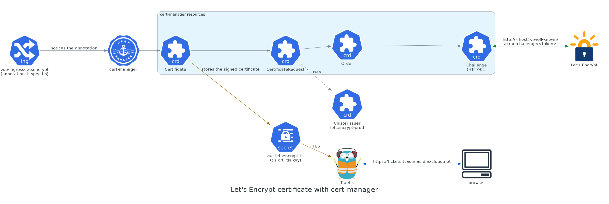

# cert-manager: Let's Encrypt certificates for the public Ingress

[cert-manager](https://cert-manager.io/) is a Kubernetes controller that **issues and renews TLS certificates automatically**. You describe *who* signs certificates (an `Issuer` / `ClusterIssuer`). You then ask for a certificate with an annotation on an Ingress. cert-manager stores the result in a `Secret` that Traefik uses for HTTPS.

Here the signer is [Let's Encrypt](https://letsencrypt.org/), so the certificate is trusted by every browser. Only the **frontend** is public: the browser reaches the API through the frontend's nginx (`/api/*` → `spring:8080`), so Spring, Swagger UI and the actuator endpoints stay inside the cluster.



## Files

| File | What it is |
| --- | --- |
| [letsencrypt-prod-issuer.yaml](letsencrypt-prod-issuer.yaml) | `ClusterIssuer` **letsencrypt-prod**: ACME account at Let's Encrypt, HTTP-01 challenges through Traefik |
| [../vue/vue-ingress-letsencrypt.yaml](../vue/vue-ingress-letsencrypt.yaml) | HTTPS Ingress for the public host (requests the certificate), a Traefik `Middleware` and an HTTP Ingress that redirect `http://` to `https://` |

> This needs a cluster that is **reachable from the internet**. It does not work on minikube or in Codespaces, where Let's Encrypt cannot reach Traefik. Use the HTTP Ingress `vue.local` there ([vue/README.md](../vue/README.md)).

---

## Prerequisites

- A cluster with a public IP, e.g. the MicroK8s VM of [MICROK8S.md](../MICROK8S.md#option-c--cloud-vm-node-ip-as-external-ip), with the **Traefik** ingress controller (`kubectl get ingressclass` lists `traefik`).
- The Tickets app deployed (see [main README → Deploy the application](../README.md#3-deploy-the-application)).
- A **DNS name** whose A record points at Traefik. **Every** A record of the name must work: with a stale extra record, both cert-manager and Let's Encrypt fail whenever they pick it. `dig +short <host>` must print only working addresses.
- Ports **80 and 443** open from the internet (on a cloud VM: in the cloud firewall). Let's Encrypt validates over port 80 even though the site itself is served on 443.
- `kubectl` and `helm`. Run the commands from the **repository root**.

Check that the name reaches Traefik before you start. `404 page not found` comes from Traefik and is fine at this point:

```bash
dig +short tickets.tsadimas.dns-cloud.net
curl -i http://tickets.tsadimas.dns-cloud.net/
```

> When you create a DNS record, use a short TTL (e.g. 300 s) and do not query the name before the record exists: resolvers cache "not found" too. If you change or remove a record, resolvers keep the old answer until its TTL expires.

---

## Step 1 — Install cert-manager

```bash
helm repo add jetstack https://charts.jetstack.io --force-update

helm install cert-manager jetstack/cert-manager \
  --namespace cert-manager \
  --create-namespace \
  --version v1.21.3 \
  --set crds.enabled=true

kubectl get pods -n cert-manager     # cert-manager, cainjector, webhook: all 1/1 Running
```

- `--set crds.enabled=true` also installs the **CRDs** (`Certificate`, `Issuer`, `ClusterIssuer`, …). Without them Kubernetes does not know these resource types.
- `--version` pins the version so every student gets the same result.

> If the next step fails with `failed calling webhook "webhook.cert-manager.io"`, the webhook is not ready yet. Wait 30 seconds and try again.

## Step 2 — Create the ClusterIssuer

A `ClusterIssuer` can be used from **any namespace**. An `Issuer` only works in its own namespace.

```bash
kubectl apply -f cert/letsencrypt-prod-issuer.yaml
kubectl get clusterissuer            # letsencrypt-prod   READY True
```

`READY True` means cert-manager registered an ACME account at Let's Encrypt. Its key is kept in the secret `letsencrypt-prod-account-key` in the `cert-manager` namespace. An email address is optional. Add `email:` to the issuer to get expiry warnings.

## Step 3 — Set your host name

Replace `tickets.tsadimas.dns-cloud.net` in [vue/vue-ingress-letsencrypt.yaml](../vue/vue-ingress-letsencrypt.yaml) with your own name (in `spec.tls` and in both `rules`). The parts that matter:

```yaml
metadata:
  annotations:
    cert-manager.io/cluster-issuer: letsencrypt-prod             # cert-manager: which issuer signs
    traefik.ingress.kubernetes.io/router.entrypoints: websecure   # Traefik: listen on 443
    traefik.ingress.kubernetes.io/router.tls: "true"              # Traefik: terminate TLS
spec:
  tls:
    - hosts:
        - tickets.tsadimas.dns-cloud.net   # the certificate is issued for this name
      secretName: vue-letsencrypt-tls      # cert-manager writes the certificate here
```

## Step 4 — Request the certificate

```bash
kubectl apply -f vue/vue-ingress-letsencrypt.yaml
kubectl get certificate -w              # vue-letsencrypt-tls → READY True, usually within a minute (Ctrl+C to stop)
kubectl get challenge                   # while it is pending: one Challenge per host name
```

What happens (HTTP-01):

1. cert-manager creates a `Certificate`, an `Order` at Let's Encrypt and one `Challenge` per name.
2. It starts a small **solver pod** and a temporary Ingress that answers `http://<host>/.well-known/acme-challenge/<token>`.
3. It fetches that URL itself first (*self check*), then asks Let's Encrypt to fetch it from the internet.
4. When Let's Encrypt gets the right answer, it signs the certificate. cert-manager stores it in `vue-letsencrypt-tls` and removes the solver.

Until then Traefik serves its own `TRAEFIK DEFAULT CERT`, so the browser shows a warning.

> **Rate limits:** Let's Encrypt allows only a few certificates per exact set of names per week (5 at the time of writing). Do not delete and re-create the secret in a loop. For experiments, copy the issuer with `server: https://acme-staging-v02.api.letsencrypt.org/directory` and another name: staging has generous limits but its certificates are not trusted.

## Step 5 — Test

```bash
kubectl get secret vue-letsencrypt-tls -o jsonpath='{.data.tls\.crt}' | base64 -d \
  | openssl x509 -noout -subject -issuer -dates        # issuer: Let's Encrypt

curl -I https://tickets.tsadimas.dns-cloud.net/                       # 200, no -k needed
curl -si https://tickets.tsadimas.dns-cloud.net/api/me | head -1       # 401 from Spring: through nginx, a token is needed
curl -s -o /dev/null -w '%{http_code} %{redirect_url}\n' http://tickets.tsadimas.dns-cloud.net/   # 301 https://...
```

Open the site in the browser and log in as `alice` / `password`. Login goes through Keycloak, which needs its own public name and certificate: see [Keycloak.md → Public HTTPS](../Keycloak.md#7-public-https).

### HTTP → HTTPS redirect

[vue-ingress-letsencrypt.yaml](../vue/vue-ingress-letsencrypt.yaml) also contains:

- a Traefik **Middleware** `redirect-https` (`redirectScheme: https`, `permanent: true` → status 301 for GET, 308 for other methods, so `curl -I`, which sends HEAD, shows 308). Middlewares are Traefik CRDs, installed with the Traefik chart.
- an Ingress `vue-ingress-letsencrypt-http` on the `web` entrypoint (port 80) for the same host, with the annotation `traefik.ingress.kubernetes.io/router.middlewares: default-redirect-https@kubernetescrd` (`<namespace>-<name>@kubernetescrd`).

Only this host is redirected. Renewals still work: cert-manager's temporary challenge Ingress has a longer path, so Traefik routes `/.well-known/acme-challenge/<token>` to the solver before the redirect catches it.

## Renewal

Let's Encrypt certificates are valid for 90 days. cert-manager renews them automatically about 30 days before they expire, with the same HTTP-01 challenge, so ports 80 and the DNS record must stay in place.

```bash
kubectl describe certificate vue-letsencrypt-tls | grep -E "Not After|Renewal Time"
```

---

## Troubleshooting

Follow the chain from top to bottom. The first resource that is not `Ready` / `valid` tells you where the problem is:

```bash
kubectl get certificate,certificaterequest,order,challenge
kubectl describe challenge | grep -A3 Reason
kubectl logs -n cert-manager deploy/cert-manager
```

| Symptom | Likely cause |
| --- | --- |
| No `Certificate` appears | annotation missing or misspelled, or `spec.tls` missing from the Ingress |
| `Certificate` stuck at `READY False`, no `Challenge` | issuer name wrong (`kubectl get clusterissuer`), or the issuer is not Ready |
| Challenge `pending`: `failed to perform self check ... context deadline exceeded` | the cluster cannot reach `http://<host>/`: a stale A record, wrong IP, or port 80 closed. Test every address (below) |
| Challenge `invalid` | Let's Encrypt could not fetch the token from the internet: firewall, DNS, or port 80 not routed to Traefik |
| Browser shows `TRAEFIK DEFAULT CERT` | the certificate is not issued yet (`kubectl get certificate`) |
| `failed calling webhook` on apply | cert-manager webhook not ready yet. Wait and retry |
| `too many certificates already issued` | production rate limit. Wait, or test with a staging issuer |

Test every address of the name from inside the cluster (`200` or `404` = reachable, `000` = not):

```bash
for ip in $(dig +short tickets.tsadimas.dns-cloud.net); do
  kubectl run nettest-${ip//./-} --rm -i --restart=Never --image=curlimages/curl -- \
    curl -s -m 5 -o /dev/null -w "$ip %{http_code}\n" \
    --resolve tickets.tsadimas.dns-cloud.net:80:$ip http://tickets.tsadimas.dns-cloud.net/
done
```

See also the official [troubleshooting guide](https://cert-manager.io/docs/troubleshooting/).

## Uninstall

```bash
kubectl delete -f vue/vue-ingress-letsencrypt.yaml --ignore-not-found
kubectl delete secret vue-letsencrypt-tls --ignore-not-found
kubectl delete -f cert/letsencrypt-prod-issuer.yaml
helm uninstall cert-manager -n cert-manager
kubectl delete namespace cert-manager
```

> `helm uninstall` keeps the CRDs, to protect existing certificates. To remove them as well, run `kubectl get crds -o name | grep cert-manager.io | xargs kubectl delete`. This deletes **every** cert-manager resource in the cluster.

## Links

- [cert-manager: install with Helm](https://cert-manager.io/docs/installation/helm/)
- [cert-manager: securing Ingress resources](https://cert-manager.io/docs/usage/ingress/)
- [cert-manager: troubleshooting](https://cert-manager.io/docs/troubleshooting/)
- [Let's Encrypt: rate limits](https://letsencrypt.org/docs/rate-limits/)
- [Let's Encrypt: challenge types](https://letsencrypt.org/docs/challenge-types/)
- [Traefik: Kubernetes Ingress provider and annotations](https://doc.traefik.io/traefik/providers/kubernetes-ingress/)
- [Traefik: RedirectScheme middleware](https://doc.traefik.io/traefik/middlewares/http/redirectscheme/)
