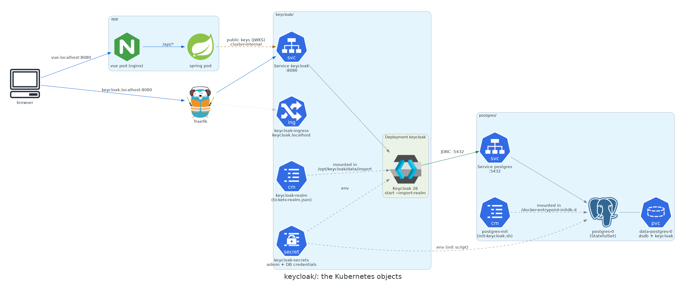

# Keycloak: identity provider

[Keycloak](https://www.keycloak.org/) is an open-source **identity and access management** server. It shows the login page, stores the users and their roles, and issues signed **tokens** (OpenID Connect / OAuth 2.0). Applications do not handle passwords at all: they trust the tokens.

This directory runs Keycloak in the cluster for the Tickets app. **How the backend and the frontend use it** is explained in **[Keycloak.md](../Keycloak.md)** in the root folder. This README covers Keycloak itself: the manifests, the realm, the admin console and troubleshooting.

| File | What it creates |
| --- | --- |
| [keycloak-secret.yaml](keycloak-secret.yaml) | Secret `keycloak-secrets`: the first admin user and the database credentials |
| [realm/tickets-realm.json](realm/tickets-realm.json) | the realm `tickets`: clients, roles, demo users. Loaded into the ConfigMap `keycloak-realm` |
| [keycloak-deployment.yaml](keycloak-deployment.yaml) | Deployment `keycloak` (image `quay.io/keycloak/keycloak:26.8.2`), production mode, imports the realm |
| [keycloak-svc.yaml](keycloak-svc.yaml) | ClusterIP Service `keycloak`, port 8080 |
| [keycloak-ingress.yaml](keycloak-ingress.yaml) | HTTP Ingress for **`keycloak.localhost`** (Traefik, entrypoint `web`) |
| [keycloak-ingress-letsencrypt.yaml](keycloak-ingress-letsencrypt.yaml) | public **HTTPS** Ingress with Let's Encrypt, only on a cluster reachable from the internet |

Keycloak's database lives in the **shared** `postgres` StatefulSet (see [postgres/README.md](../postgres/README.md)). The `keycloak` database and user are created by an init script ([postgres/postgres-init.yaml](../postgres/postgres-init.yaml)) on the first start of that pod.



The browser talks to Keycloak **directly** (login page, token requests). The Spring backend only downloads Keycloak's **public keys** over the internal Service, to verify the signature of the tokens.

---

## Prerequisites

| What | Why | How to check |
| --- | --- | --- |
| Traefik ingress controller | serves `keycloak-ingress.yaml` | `kubectl get ingressclass` ([main README](../README.md#install-the-traefik-ingress-controller)) |
| `postgres` StatefulSet running | Keycloak's database is the `keycloak` database on the shared postgres | `kubectl get statefulset postgres` ([postgres/README.md](../postgres/README.md)) |
| ~1 GB free memory | Keycloak is a Java (Quarkus) server; the limit is 1Gi | `kubectl top nodes` (needs metrics-server) |

---

## Deploy

```bash
# 1. credentials (change the passwords first for anything but a local playground)
#    Must be applied BEFORE postgres so the init script can read the credentials.
kubectl apply -f keycloak/keycloak-secret.yaml

# 2. the realm, as a ConfigMap built from the JSON file
kubectl create configmap keycloak-realm --from-file=keycloak/realm/tickets-realm.json

# 3. Keycloak, its Service and Ingress
#    (postgres must already be running — it hosts the "keycloak" database)
kubectl apply -f keycloak/keycloak-deployment.yaml -f keycloak/keycloak-svc.yaml -f keycloak/keycloak-ingress.yaml
kubectl rollout status deployment/keycloak --timeout=5m
```

> Do not use `kubectl apply -f keycloak/`: it would also apply `keycloak-ingress-letsencrypt.yaml`, which is for a public cluster only.

The **first start takes 1–2 minutes**: Keycloak runs a build step for the selected options (PostgreSQL, health checks), creates its database tables and imports the realm. Follow it with:

```bash
kubectl logs deploy/keycloak -f
# ... Keycloak 26.8.2 on JVM (powered by Quarkus ...) started in ...
# ... Profile prod activated.
# ... Realm 'tickets' imported
```

### Why the realm is a ConfigMap built with `kubectl create`

The realm is kept as a normal JSON file ([realm/tickets-realm.json](realm/tickets-realm.json)), so it can be edited with any JSON tool and also used with `docker run` (see [Keycloak.md](../Keycloak.md#6-local-development-without-kubernetes)). `kubectl create configmap --from-file` turns it into a ConfigMap with one key, `tickets-realm.json`. The Deployment mounts the ConfigMap as files in `/opt/keycloak/data/import/`, and `--import-realm` imports every `*.json` file there.

See what was created:

```bash
kubectl get configmap keycloak-realm -o yaml | head -20
kubectl exec deploy/keycloak -- ls /opt/keycloak/data/import      # tickets-realm.json
```

To update the ConfigMap after editing the JSON (`create` fails if it already exists):

```bash
kubectl create configmap keycloak-realm --from-file=keycloak/realm/tickets-realm.json \
  --dry-run=client -o yaml | kubectl apply -f -
```

But read [Changing the realm](#changing-the-realm) first: an existing realm is **not** re-imported.

---

## Configuration

Keycloak is configured with `KC_*` environment variables ([all options](https://www.keycloak.org/server/all-config)) in [keycloak-deployment.yaml](keycloak-deployment.yaml):

| Variable | Value | Meaning |
| --- | --- | --- |
| *(args)* | `start --import-realm` | **production mode**. `start-dev` would use an embedded H2 database, plain HTTP everywhere and caching off: fine on a laptop, not in a cluster |
| `KC_DB`, `KC_DB_URL` | `postgres`, `jdbc:postgresql://postgres:5432/keycloak` | Keycloak's database on the shared postgres StatefulSet |
| `KC_DB_USERNAME`, `KC_DB_PASSWORD` | from Secret `keycloak-secrets` | the user and database created by [postgres/postgres-init.yaml](../postgres/postgres-init.yaml) on first init |
| `KC_BOOTSTRAP_ADMIN_USERNAME`, `..._PASSWORD` | from Secret `keycloak-secrets` | temporary admin of the `master` realm, created only when the database is **empty** |
| `KC_HTTP_ENABLED` | `true` | allow plain HTTP. TLS is terminated by Traefik, which forwards plain HTTP inside the cluster |
| `KC_HOSTNAME_STRICT` | `false` | no fixed public URL: Keycloak uses the URL each request was sent to (see below) |
| `KC_PROXY_HEADERS` | `xforwarded` | trust `X-Forwarded-Host/-Port/-Proto` from Traefik, so behind HTTPS Keycloak knows it is `https://...` |
| `KC_HEALTH_ENABLED` | `true` | `/health/started`, `/health/ready`, `/health/live` on the **management port 9000** |

### Hostname and the token issuer

Every token contains the claim `iss` (issuer), the URL of the realm, e.g. `http://keycloak.localhost:8080/realms/tickets`. The backend accepts a token only if `iss` is **exactly** the URL it is configured with.

With `KC_HOSTNAME_STRICT=false` Keycloak builds `iss` from the URL of the request. So:

| Token requested at | `iss` in the token |
| --- | --- |
| `http://keycloak.localhost:8080` (browser, through Traefik) | `http://keycloak.localhost:8080/realms/tickets` |
| `https://keycloak.tsadimas.dns-cloud.net` (public Ingress) | `https://keycloak.tsadimas.dns-cloud.net/realms/tickets` |
| `http://keycloak:8080` (from inside the cluster) | `http://keycloak:8080/realms/tickets`, rejected by the backend, which expects the browser's URL |

This keeps the playground flexible (the same Deployment works locally and publicly). In a real installation, fix the URL with `KC_HOSTNAME=https://auth.example.com`. Keycloak then always uses it, whatever the request URL, and the admin console can be limited to another name with `KC_HOSTNAME_ADMIN`.

### Probes

Keycloak serves its health endpoints on the separate **management port 9000**, which is not part of the Service and therefore never reachable through the Ingress.

| Probe | Path | Purpose |
| --- | --- | --- |
| startup | `/health/started` | allows up to 5 minutes (60 × 5 s) for the first start. Liveness and readiness wait until it succeeds |
| readiness | `/health/ready` | Keycloak is initialized and can serve requests. Not ready, so no traffic from the Service |
| liveness | `/health/live` | restart the container if Keycloak hangs |

The Keycloak image is minimal (no `curl`, no `wget`, no package manager), so `kubectl exec ... curl` does not work. Use a port-forward instead:

```bash
kubectl port-forward deploy/keycloak 9000:9000      # terminal 1
curl -s localhost:9000/health/ready | jq            # terminal 2
# { "status": "UP", "checks": [ { "name": "Keycloak Initialized", "status": "UP" }, ... ] }
```

---

## The realm `tickets`

A **realm** is an isolated set of users, roles and clients. The `master` realm is only for administering Keycloak; applications get their own realm. [realm/tickets-realm.json](realm/tickets-realm.json) contains:

### Clients

A **client** is an application that uses Keycloak.

| Client | Type | Used by | Settings |
| --- | --- | --- | --- |
| `tickets-backend` | bearer-only | the Spring API | never logs anyone in. It **owns the roles** `USER` and `AGENT`, and it is the **audience** (`aud`) of the tokens |
| `tickets-frontend` | public, Authorization Code + **PKCE** (S256) | the Vue app | redirect URIs `http://vue.localhost:8080/*`, `http://localhost:5173/*` (Vite dev), `http://localhost:8081/*` (Docker Compose), `https://tickets.tsadimas.dns-cloud.net/*`. Web origins `+` (= the redirect URIs' origins, for CORS). Password grant disabled |
| `tickets-cli` | public, **password grant** only | `curl`, Swagger UI | to get a token on the command line. **Testing only**: the password grant gives the password to the client and is removed in OAuth 2.1 |

A **public** client has no secret, because code that runs in a browser cannot keep one. PKCE protects the authorization code instead: only the app that started the login can exchange the code for a token.

### Roles and users

`USER` and `AGENT` are **client roles** of `tickets-backend`: roles that belong to the API that checks them.

| User | Password | Role | Email |
| --- | --- | --- | --- |
| `alice` | `password` | `USER` | alice@example.com |
| `bob` | `password` | `USER` | bob@example.com |
| `agent` | `password` | `AGENT` | agent@example.com |

### Protocol mappers: what goes into the token

A **protocol mapper** is a rule that decides what goes into a token. When Keycloak issues a token for a client, it runs that client's mappers. Each one adds a claim to the token, or shapes one, using data about the user, the client or the session. They are called *protocol* mappers because there is one kind per protocol: OpenID Connect mappers write JWT claims, SAML mappers write SAML attributes. This realm uses only OpenID Connect.

Mappers matter because the backend makes its decisions **from the token alone**. It never asks Keycloak who the user is or which roles they have. Everything it needs must already be in the token, in the shape it expects.

#### The mappers of this realm

`tickets-frontend` and `tickets-cli` each have two mappers that shape the access token for the backend:

| Mapper | Type (`protocolMapper`) | Claim in the access token | Why |
| --- | --- | --- | --- |
| `audience tickets-backend` | Audience (`oidc-audience-mapper`) | `"aud": "tickets-backend"` | the backend accepts only tokens meant for it (`KEYCLOAK_AUDIENCE`). Without it, a token issued for another API of the realm would work here too |
| `roles of tickets-backend` | User Client Role (`oidc-usermodel-client-role-mapper`) | `"roles": ["USER"]` | the user's client roles of `tickets-backend`, as a simple top-level list |

The configuration of the roles mapper in [realm/tickets-realm.json](realm/tickets-realm.json), field by field:

| Setting | Value | Meaning |
| --- | --- | --- |
| `usermodel.clientRoleMapping.clientId` | `tickets-backend` | whose client roles to take |
| `claim.name` | `roles` | the name of the claim in the token |
| `multivalued` | `true` | a list, not a single value |
| `access.token.claim` | `true` | in the **access token**, which the API reads |
| `id.token.claim` | `false` | not in the ID token, which only the frontend reads |
| `userinfo.token.claim` | `false` | not in the `/userinfo` response |

**Why a roles mapper at all?** Keycloak already includes the client roles, but nested: `"resource_access": {"tickets-backend": {"roles": ["USER"]}}`. Spring Security's standard `JwtGrantedAuthoritiesConverter` reads only a top-level claim, so the nested form would need custom Java code. The mapper copies the roles to where the standard converter finds them: `setAuthoritiesClaimName("roles")` in [SecurityConfig.java](../backend/src/main/java/gr/hua/dit/tickets/config/SecurityConfig.java).

#### Mappers you get without configuring them: client scopes

Not every claim comes from the mappers above. A **client scope** is a reusable bundle of mappers. Keycloak creates a few in every realm and attaches them to every client by default:

| Default client scope | Some of its mappers | Claims |
| --- | --- | --- |
| `profile` | username, full name, given name, family name | `preferred_username`, `name`, `given_name`, `family_name` |
| `email` | email, email verified | `email`, `email_verified` |
| `roles` | realm roles, client roles, audience resolve | `realm_access`, `resource_access`, `aud` of clients whose roles the user has |

`preferred_username`, which the backend uses as the user name, comes from the `profile` scope, not from a mapper of this realm. The mappers of a single client (like the two above) live in that client's *dedicated* scope, `tickets-frontend-dedicated`.

#### Other common mapper types

| Type | Example use |
| --- | --- |
| User Attribute | copy a custom user attribute (e.g. `department`) into a claim |
| Hardcoded claim | always add a fixed value (e.g. `"tenant": "hua"`) |
| Group Membership | add the user's groups (e.g. `"groups": ["/support"]`) |
| User Realm Role | like User Client Role, but for realm roles |
| Script / custom | logic Keycloak does not ship with (needs a deployed extension) |

#### Seeing them in action

In the [admin console](#admin-console), realm **tickets**:

- the mappers: *Clients* → `tickets-frontend` → *Client scopes* → `tickets-frontend-dedicated`
- the result: *Client scopes* → *Evaluate* → pick a user → *Generated access token*. Remove a mapper and its claim disappears from the preview.

From the command line (Traefik port-forward running):

```bash
curl -s http://keycloak.localhost:8080/realms/tickets/protocol/openid-connect/token \
  -d grant_type=password -d client_id=tickets-cli -d username=agent -d password=password \
  | jq -r .access_token | cut -d. -f2 | tr '_-' '/+' | base64 -d 2>/dev/null | jq '{aud, roles, resource_access}'
# {"aud": "tickets-backend", "roles": ["AGENT"], "resource_access": {"tickets-backend": {"roles": ["AGENT"]}}}
```

`aud` and `roles` come from this realm's two mappers; `resource_access` comes from the default `roles` scope.

> **Keep tokens small and need-to-know.** A JWT is signed, not encrypted: anyone who holds the token can decode it. Every mapper also makes every request bigger. Map only what the receiving API needs, and put claims meant for the API in the access token only.

#### A decoded access token

A decoded access token for `alice` (abridged):

```json
{
  "iss": "http://keycloak.localhost:8080/realms/tickets",
  "aud": "tickets-backend",
  "azp": "tickets-frontend",
  "sub": "86b7d421-2055-48ba-98c4-1ba51ca61468",
  "preferred_username": "alice",
  "roles": ["USER"],
  "resource_access": { "tickets-backend": { "roles": ["USER"] } },
  "exp": 1795530000
}
```

Access tokens live **5 minutes** (`accessTokenLifespan: 300`); the frontend refreshes them in the background with the refresh token. The login session ends after **30 minutes** without activity (`ssoSessionIdleTimeout: 1800`).

---

## Admin console

With the Traefik port-forward running (`kubectl port-forward -n traefik svc/traefik 8080:80`), open <http://keycloak.localhost:8080/admin> and log in with the admin from the Secret (`admin` / `admin`).

> The admin console, like the Tickets frontend, needs a browser **secure context**. `http://keycloak.localhost` is one; `http://keycloak.local` or an IP address over plain HTTP is not, and the console fails with *"Web Crypto API is not available"*.

Switch to the realm **tickets** (top-left drop-down) and try:

| Task | Where |
| --- | --- |
| Add a user | *Users* → *Add user* (fill in email, first and last name, otherwise Keycloak asks for them at the first login) → *Credentials* → *Set password* (turn off *Temporary*) |
| Give a user a role | *Users* → user → *Role mapping* → *Assign role* → filter *Client roles* → `tickets-backend` `USER` or `AGENT` |
| See the token a user would get | *Clients* → `tickets-frontend` → *Client scopes* → *Evaluate* → pick a user → *Generated access token* |
| See active logins / log someone out | *Sessions* |
| Let users register themselves | *Realm settings* → *Login* → *User registration* (new users have no role, so ask an AGENT to assign one) |
| Change the login page language/theme | *Realm settings* → *Themes* / *Localization* |

The temporary admin user shows a warning banner. For a lasting setup, create a permanent admin user in the `master` realm and delete the temporary one.

---

## Changing the realm

`--import-realm` imports a realm **only if it does not exist yet** (strategy `IGNORE_EXISTING`). After the first start the realm lives in the database, so:

- changes made in the **admin console** are permanent (they survive restarts), and
- changes to **`tickets-realm.json`** have **no effect** on an existing realm.

To apply an edited JSON file, start from an empty realm:

```bash
# a) delete only the realm: admin console → realm "tickets" → Realm settings → Action (top right) → Delete
#    then restart Keycloak to import it again
kubectl create configmap keycloak-realm --from-file=keycloak/realm/tickets-realm.json --dry-run=client -o yaml | kubectl apply -f -
kubectl rollout restart deployment/keycloak

# b) or wipe all of Keycloak's data (drop the keycloak database from the shared postgres)
kubectl delete -f keycloak/keycloak-deployment.yaml
kubectl exec -it postgres-0 -- psql -U dbuser -c "DROP DATABASE keycloak;" -c "DROP USER keycloak;"
# ... then deploy Keycloak again (postgres re-runs the init script only on a fresh PVC;
#     for an existing PVC you must recreate the database manually as above)
```

To go the other way and save the changes you made in the console as JSON: *Realm settings* → *Action* → *Partial export* (users and secrets are not included).

---

## Testing

All commands assume the Traefik port-forward on port 8080 is running:

```bash
kubectl port-forward -n traefik svc/traefik 8080:80
```

`curl` and most browsers resolve `*.localhost` to the loopback address themselves, so no `/etc/hosts` entry is needed. If yours does not, add `127.0.0.1 keycloak.localhost vue.localhost` to `/etc/hosts`.

```bash
# OpenID Connect discovery document: every endpoint of the realm
curl -s http://keycloak.localhost:8080/realms/tickets/.well-known/openid-configuration | jq '{issuer, authorization_endpoint, token_endpoint, jwks_uri}'

# public signing keys, which the backend downloads
curl -s http://keycloak.localhost:8080/realms/tickets/protocol/openid-connect/certs | jq '.keys[] | {kid, alg, use}'

# a token for alice (tickets-cli, password grant)
TOKEN=$(curl -s http://keycloak.localhost:8080/realms/tickets/protocol/openid-connect/token \
  -d grant_type=password -d client_id=tickets-cli -d username=alice -d password=password | jq -r .access_token)

# decode its payload (the middle part of the JWT, base64url)
echo "$TOKEN" | cut -d. -f2 | tr '_-' '/+' | base64 -d 2>/dev/null | jq '{iss, aud, preferred_username, roles, exp}'
```

Or paste the token into <https://jwt.io>, which decodes it in the browser. Never paste production tokens into a website.

From inside the cluster, through the Service (this is how the backend reaches Keycloak):

```bash
kubectl run -it --rm curl --image=curlimages/curl --restart=Never -- \
  curl -s http://keycloak:8080/realms/tickets/protocol/openid-connect/certs
```

---

## Public HTTPS

On a cluster reachable from the internet (see [cert/README.md](../cert/README.md)):

1. Create a DNS record for the Keycloak host name pointing at Traefik, and set that name in [keycloak-ingress-letsencrypt.yaml](keycloak-ingress-letsencrypt.yaml) (default `keycloak.tsadimas.dns-cloud.net`).
2. Apply `vue/vue-ingress-letsencrypt.yaml` first: it defines the `redirect-https` Middleware that this file reuses.
3. `kubectl apply -f keycloak/keycloak-ingress-letsencrypt.yaml` and wait for `kubectl get certificate keycloak-letsencrypt-tls` → `READY True`.
4. Point the backend and the frontend at the public URL, as described in [Keycloak.md → Public HTTPS](../Keycloak.md#7-public-https).

Behind HTTPS, `KC_PROXY_HEADERS=xforwarded` is what makes Keycloak generate `https://` URLs: Traefik terminates TLS and sends `X-Forwarded-Proto: https`.

---

## Troubleshooting

| Symptom | Likely cause |
| --- | --- |
| Pod `0/1` for minutes, restarts | first start is slow (build + schema). Check `kubectl logs deploy/keycloak`. If the startup probe gave up, the database may be unreachable |
| Log: `Connection to postgres:5432 refused` | `postgres-0` is not Ready yet. `kubectl rollout status statefulset/postgres` |
| Log: `password authentication failed for user "keycloak"` | the Secret was changed after the database was created. Restore it, or drop and recreate the user: `kubectl exec -it postgres-0 -- psql -U dbuser -c "ALTER USER keycloak WITH PASSWORD 'new-pass';"` |
| Log: `database "keycloak" does not exist` | the init script did not run (PVC already existed). Create the database manually: `kubectl exec -it postgres-0 -- psql -U dbuser -c "CREATE USER keycloak WITH PASSWORD 'keycloak-db-pass'; CREATE DATABASE keycloak OWNER keycloak;"` |
| Pod `ContainerCreating`, event `configmap "keycloak-realm" not found` | step 3 of [Deploy](#deploy) was skipped |
| Pod `OOMKilled` | raise `limits.memory`; Keycloak needs at least ~700 MiB |
| Browser: *"Web Crypto API is not available"* | page opened over plain HTTP on a name other than `localhost` / `*.localhost`. Use `keycloak.localhost` / `vue.localhost`, or HTTPS |
| Browser: *"Invalid parameter: redirect_uri"* | the app's URL is not in the client's *Valid redirect URIs*. Add it in the admin console (*Clients* → `tickets-frontend`) |
| Browser: *"HTTPS required"* | `sslRequired: external` and Keycloak thinks the request comes from a public IP over HTTP. Use HTTPS, or (playground only) set *Realm settings* → *Require SSL* to *none* |
| Admin login fails, `admin` / `admin` | the bootstrap admin is created only on the **first** start; later Secret changes are ignored |
| `404 page not found` (plain text) on `keycloak.localhost` | Traefik has no matching route. Check `kubectl get ingress keycloak-ingress` and the `Host` you use |

## Clean up

```bash
kubectl delete -f keycloak/keycloak-ingress.yaml -f keycloak/keycloak-svc.yaml -f keycloak/keycloak-deployment.yaml --ignore-not-found
kubectl delete configmap keycloak-realm --ignore-not-found
kubectl delete -f keycloak/keycloak-secret.yaml --ignore-not-found
# To also remove Keycloak's data from the shared postgres:
kubectl exec -it postgres-0 -- psql -U dbuser -c "DROP DATABASE IF EXISTS keycloak; DROP USER IF EXISTS keycloak;"
```

## Links

- [Keycloak: running in a container](https://www.keycloak.org/server/containers)
- [Keycloak: configuring the hostname](https://www.keycloak.org/server/hostname) and [reverse proxy](https://www.keycloak.org/server/reverseproxy)
- [Keycloak: health checks](https://www.keycloak.org/observability/health)
- [Keycloak: importing and exporting realms](https://www.keycloak.org/server/importExport)
- [Keycloak Server Administration Guide](https://www.keycloak.org/docs/latest/server_admin/)
- [Secure contexts (MDN)](https://developer.mozilla.org/en-US/docs/Web/Security/Secure_Contexts)
