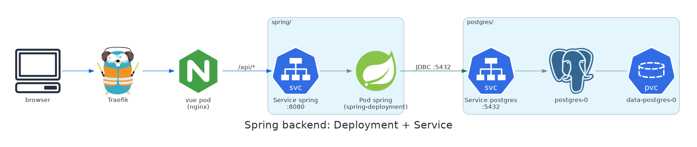

# Spring Boot backend: Deployment + Service

The Spring Boot REST API of the Tickets app (source in [backend/](../backend/README.md)). It stores its data in the PostgreSQL database from [postgres/](../postgres/README.md).

The backend has **no Ingress**: it is not reachable from outside the cluster. The [Vue frontend](../vue/README.md)'s nginx forwards every `/api/*` request to the Service `spring`, so the browser only ever talks to the frontend. For Swagger UI or direct API tests, use `kubectl port-forward` (see [Testing](#testing)).

- `spring-deployment.yaml` – the Deployment: image `ghcr.io/tsadimas/cp-spring:keycloak` (built from [backend/Dockerfile.multistage](../backend/Dockerfile.multistage)), database connection through environment variables (see below), liveness/readiness probes on Spring Boot Actuator, resource limits, `imagePullSecrets: registry-credentials`
- `spring-deployment-letsencrypt.yaml` – same Deployment with `KEYCLOAK_ISSUER_URI=https://keycloak.tsadimas.dns-cloud.net/realms/tickets`; apply instead of `spring-deployment.yaml` when using `keycloak-ingress-letsencrypt.yaml`
- `spring-svc.yaml` – ClusterIP Service `spring`, port 8080 (port name `spring`)



## Configuration

[application.properties](../backend/src/main/resources/application.properties) builds the JDBC URL from environment variables, and the Deployment sets them:

| Variable | Value in the Deployment | Used for |
| --- | --- | --- |
| `DB_HOST` | `postgres` | the PostgreSQL Service name |
| `DB_PORT` | not set, default `5432` | |
| `DB_NAME` / `DB_USER` / `DB_PASSWORD` | `dsdb` / `dbuser` / `pass123` | must match `POSTGRES_DB` / `POSTGRES_USER` / `POSTGRES_PASSWORD` in [postgres-statefulset.yaml](../postgres/postgres-statefulset.yaml) |
| `KEYCLOAK_ISSUER_URI` | `http://keycloak.localhost:8080/realms/tickets` (local) / `https://keycloak.tsadimas.dns-cloud.net/realms/tickets` (public HTTPS) | must equal the `iss` claim of the tokens = Keycloak's URL **as the browser sees it** |
| `KEYCLOAK_JWK_SET_URI` | `http://keycloak:8080/realms/tickets/protocol/openid-connect/certs` | where Spring downloads Keycloak's public keys (the internal Service) |
| `JAVA_TOOL_OPTIONS` | `-XX:MaxRAMPercentage=60.0` | heap = 60% of the 512Mi limit, leaving room for the JVM's non-heap memory |

Result: `jdbc:postgresql://postgres:5432/dsdb`.

**Endpoints** (all on port 8080):

| Path | Access |
| --- | --- |
| `/actuator/health`, `/actuator/health/liveness`, `/actuator/health/readiness` | no login, used by the probes |
| `/swagger-ui.html`, `/v3/api-docs` | no login, Swagger UI with an *Authorize* button |
| `/api/**` | `Authorization: Bearer <token>`: a Keycloak access token ([Keycloak.md](../Keycloak.md#3-backend-an-oauth2-resource-server)). Demo users (password `password`): `alice`, `bob` (USER), `agent` (AGENT) |
| anything else | denied by Spring Security: `401` without credentials, `403` with them |

## Prerequisites

| What | Why | How to check |
| --- | --- | --- |
| PostgreSQL running | Spring connects to `jdbc:postgresql://postgres:5432/dsdb` on startup and fails without it | `kubectl rollout status statefulset/postgres` ([postgres/README.md](../postgres/README.md)) |
| Secret `registry-credentials` | needed only if the image is **private**. For a public image Kubernetes logs a warning and pulls anonymously | `kubectl get secret registry-credentials` ([main README → Container registry](../README.md#2-container-registry-github-packages)) |

## Deploy

```bash
kubectl apply -f spring/

kubectl rollout status deployment/spring-deployment
kubectl get deploy,pods,svc -l app=spring
```

The pod becomes `READY 1/1` only after the **readiness probe** (`/actuator/health/readiness`) succeeds. Both probes start after 30 s (`initialDelaySeconds`), so allow about a minute.

| Probe | Path | If it fails |
| --- | --- | --- |
| readiness | `/actuator/health/readiness` | the pod is removed from the Service endpoints, so it gets no traffic. It is **not** restarted |
| liveness | `/actuator/health/liveness` | after 20 failures (≈ 200 s) the container is **restarted** |

```bash
kubectl logs deploy/spring-deployment -f       # startup log, DB connection errors
kubectl get endpoints spring                   # empty until the pod is Ready
```

Check that Spring really uses the StatefulSet's database:

```bash
kubectl logs deploy/spring-deployment | grep -A1 "HikariPool-1 - Start"      # Start completed
kubectl exec postgres-0 -- psql -U dbuser -d dsdb -c '\dt'                     # table "ticket"
kubectl exec postgres-0 -- psql -U dbuser -d dsdb -c 'select id, title, created_by from ticket'
```

## Testing

Port-forward straight to the Service and leave it running. Port 8081 locally, because 8080 is used by the Traefik port-forward of the main README, which is needed to get a token from Keycloak:

```bash
kubectl port-forward svc/spring 8081:8080
```

In a second terminal:

```bash
curl http://localhost:8081/actuator/health          # {"status":"UP"}
curl -si http://localhost:8081/api/me | head -3     # 401, WWW-Authenticate: Bearer

# a token for alice from Keycloak (through Traefik, so that "iss" matches KEYCLOAK_ISSUER_URI)
TOKEN=$(curl -s http://keycloak.localhost:8080/realms/tickets/protocol/openid-connect/token \
  -d grant_type=password -d client_id=tickets-cli -d username=alice -d password=password | jq -r .access_token)
curl -H "Authorization: Bearer $TOKEN" http://localhost:8081/api/me       # {"username":"alice","roles":["USER"]}
curl -H "Authorization: Bearer $TOKEN" http://localhost:8081/api/tickets
```

Swagger UI: <http://localhost:8081/swagger-ui.html> (*Authorize*, paste the token).

If this fails, the problem is in the pod or the database. Check `kubectl logs deploy/spring-deployment`. If it works but the frontend's API calls fail, see [vue/README.md → Troubleshooting](../vue/README.md#troubleshooting).

## Troubleshooting

| Symptom | Likely cause |
| --- | --- |
| Pod `ImagePullBackOff` | private image and missing or wrong `registry-credentials` secret. Check with `kubectl describe pod -l app=spring` |
| Pod `Running` but `0/1`, restarts | readiness/liveness failing. Usually the DB is not reachable. Check `kubectl logs` and that `postgres-0` is Ready |
| `kubectl get endpoints spring` is empty | the pod is not Ready yet, or the Service selector does not match the pod labels |
| `401` on `/api/...` with a token | the `WWW-Authenticate` header says why: `iss claim is not valid` (token requested at another Keycloak URL than `KEYCLOAK_ISSUER_URI`), `Jwt expired`, `aud claim is not valid`. See [Keycloak.md → Troubleshooting](../Keycloak.md#8-troubleshooting) |
| `401` on `/` | expected: only `/api/**`, `/actuator/health` and Swagger are allowed. Try `/actuator/health` or `/swagger-ui.html` |
| Log says `password authentication failed for user "dbuser"` | `DB_USER` / `DB_PASSWORD` do not match the database. If you changed them in the StatefulSet after the first start, the old values are still in the volume (see [postgres/README.md](../postgres/README.md)) |
| Pod `OOMKilled` | the memory limit is too small for the heap. Raise `limits.memory` or lower `MaxRAMPercentage` |

## Clean up

```bash
kubectl delete -f spring/ --ignore-not-found
```
