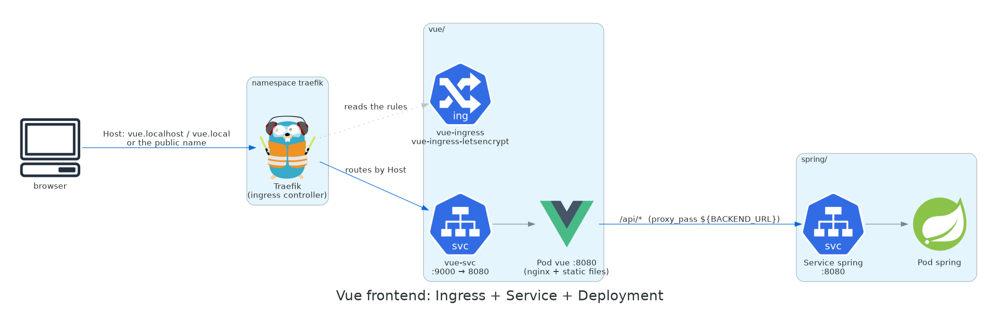

# Vue frontend: Deployment + Service + Ingress

The Vue single-page frontend of the Tickets app, and the **only part reachable from outside the cluster**. The image (built from [frontend/Dockerfile.multistage](../frontend/Dockerfile.multistage)) runs **nginx as a non-root user on port 8080**. nginx serves the static files and forwards every `/api/*` request to the Spring backend, so the browser talks to one origin only and no CORS is needed.

- `vue-deployment.yaml` – the Deployment: image `ghcr.io/tsadimas/cp-vue:2026`, `BACKEND_URL=http://spring:8080`, `KEYCLOAK_URL=http://keycloak.localhost:8080` (served to the browser as `/config.json`, see [Keycloak.md](../Keycloak.md#where-is-keycloak-configjson)), readiness/liveness probes on `/`, resource limits, `imagePullSecrets: registry-credentials`
- `vue-svc.yaml` – ClusterIP Service `vue-svc`, port **9000** → container port **8080** (port name `vue`)
- `vue-ingress.yaml` – **HTTP** Ingress for `vue.local` and `vue.localhost` (Traefik entrypoint `web`, port 80). Use `vue.localhost` in the browser: the Keycloak login needs a secure context, see [Keycloak.md](../Keycloak.md#why-localhost-host-names). For minikube, Codespaces or any cluster without a public DNS name
- `vue-ingress-letsencrypt.yaml` – **public HTTPS** for a real DNS name, with a Let's Encrypt certificate and an `http://` → `https://` redirect. Only on a cluster reachable from the internet, see [cert/README.md](../cert/README.md)



`BACKEND_URL` is substituted into [frontend/nginx/default.conf.template](../frontend/nginx/default.conf.template) when the container starts (`proxy_pass ${BACKEND_URL};`). Check the result with:

```bash
kubectl exec deploy/vue-deployment -- grep proxy_pass /etc/nginx/conf.d/default.conf
```

## Prerequisites

| What | Why | How to check |
| --- | --- | --- |
| Secret `registry-credentials` | needed only if the image is **private** | `kubectl get secret registry-credentials` ([main README → Container registry](../README.md#2-container-registry-github-packages)) |
| Traefik ingress controller | serves the Ingress (`ingressClassName: traefik`) | `kubectl get ingressclass` ([main README → Install Traefik](../README.md#install-the-traefik-ingress-controller)) |
| [Spring backend](../spring/README.md) | nginx forwards `/api/*` to the Service `spring`. That Service must **exist** before the pod starts, because nginx looks up the name on startup and exits if it cannot | `kubectl get svc spring` |
| cert-manager + `letsencrypt-prod` | only for `vue-ingress-letsencrypt.yaml` | `kubectl get clusterissuer` ([cert/README.md](../cert/README.md)) |

## Deploy

```bash
kubectl apply -f vue/vue-deployment.yaml -f vue/vue-svc.yaml -f vue/vue-ingress.yaml
kubectl rollout status deployment/vue-deployment
kubectl get deploy,pods,svc -l app=vue
kubectl get ingress
```

On a public cluster, also apply `vue/vue-ingress-letsencrypt.yaml` as described in [cert/README.md](../cert/README.md). Its two Ingresses (HTTPS, and HTTP for the redirect) use the public name, `vue-ingress` uses `vue.local`, so they can coexist.

---

## How the Ingress works

An **Ingress** is a set of HTTP routing rules: *requests for host X and path Y go to Service Z*. It does nothing on its own. The **ingress controller** (Traefik, running in namespace `traefik`) watches the Ingresses with `ingressClassName: traefik` and configures itself from them.

```yaml
# vue-ingress.yaml
metadata:
  annotations:
    traefik.ingress.kubernetes.io/router.entrypoints: web   # listen on port 80 only
spec:
  ingressClassName: traefik      # which controller serves this Ingress
  rules:
    - host: vue.local            # match the Host header of the request
      http:
        paths:
          - path: /
            pathType: Prefix     # "/" and everything below it
            backend:
              service:
                name: vue-svc    # forward to Service vue-svc ...
                port:
                  name: vue      # ... on its port named "vue" (9000)
```

Traefik routes by the **`Host` header**. A request to the right IP and port but with a different host gets `404 page not found` from Traefik, not from nginx.

[vue-ingress-letsencrypt.yaml](vue-ingress-letsencrypt.yaml) uses the same rules for the public name, plus:

- `router.entrypoints: websecure` and `router.tls: "true"`: listen on port 443 and **terminate TLS** in Traefik. Traffic from Traefik to the pod is plain HTTP inside the cluster, so nginx needs no certificate.
- `cert-manager.io/cluster-issuer: letsencrypt-prod` and `spec.tls`: cert-manager gets the certificate and stores it in the secret `vue-letsencrypt-tls`, which Traefik reads.
- a second Ingress on `web` with a Traefik `redirectScheme` Middleware, so `http://` answers with `301` → `https://`.

---

## Testing

### 1. Without the Ingress

Forward the port and leave the command running:

```bash
kubectl port-forward svc/vue-svc 9000:9000
```

In a second terminal:

```bash
curl http://localhost:9000/                              # the index.html of the app
curl -si http://localhost:9000/api/me | head -1          # 401 from Spring: through the nginx proxy, a token is needed
curl http://localhost:9000/config.json                   # where the browser finds Keycloak
```

Open <http://localhost:9000> in the browser. Logging in needs Keycloak, and a redirect URI registered for this address; the full setup is in [Keycloak.md](../Keycloak.md#5-try-it).

### 2. Through Traefik

Stop the previous port-forward, then forward Traefik's port and leave it running:

```bash
kubectl port-forward -n traefik svc/traefik 8080:80
```

In a second terminal, choose one of these ways to send the right `Host`:

```bash
# a) let curl resolve vue.local to 127.0.0.1 (no /etc/hosts change)
curl --resolve vue.local:8080:127.0.0.1 http://vue.local:8080/
curl --resolve vue.local:8080:127.0.0.1 -si http://vue.local:8080/api/me | head -1   # 401 from Spring

# b) set the Host header explicitly
curl -H "Host: vue.local" http://localhost:8080/

# c) host-based routing: an unknown host gets 404 from Traefik
curl -i -H "Host: wrong.local" http://localhost:8080/
```

In the browser open <http://vue.localhost:8080> (browsers resolve `*.localhost` to 127.0.0.1 themselves). `http://vue.local:8080` also loads the app, but the Keycloak login fails there because it is not a secure context ([Keycloak.md](../Keycloak.md#why-localhost-host-names)).

> **Codespaces:** the forwarded URL sends its own `Host` header, so it does not match `vue.local`. Test with `curl` from the Codespace terminal, or open the forwarded port of step 1 (`vue-svc`) in the browser.

### 3. Public HTTPS (real cluster)

```bash
curl -I https://tickets.tsadimas.dns-cloud.net/                       # 200, trusted certificate
curl -si https://tickets.tsadimas.dns-cloud.net/api/me | head -1     # 401 from Spring
curl -s -o /dev/null -w '%{http_code} %{redirect_url}\n' http://tickets.tsadimas.dns-cloud.net/   # 301 https://...
```

Unknown paths such as `/actuator/health` return the app's `index.html`: nginx falls back to it for every path except `/api/`, so Spring's own endpoints are not reachable from outside.

### Inspect what Traefik sees

```bash
kubectl describe ingress vue-ingress              # rules, backend, events
kubectl get ingress -A                            # all Ingresses and their class
kubectl logs -n traefik deploy/traefik            # errors such as "service not found"
```

## Troubleshooting

| Symptom | Likely cause |
| --- | --- |
| Pod `ImagePullBackOff` | private image and missing or wrong `registry-credentials` secret |
| Pod `CrashLoopBackOff`, log says `host not found in upstream "spring"` | the `spring` Service does not exist yet. Apply `spring/spring-svc.yaml`, then `kubectl rollout restart deployment/vue-deployment` |
| `404 page not found` | wrong `Host` header, or `ingressClassName` does not match an installed controller |
| `503` / `no available server` | the Service has no ready pods: `kubectl get endpoints vue-svc` |
| Page loads, but login or data fails with `502`/`504` | the Spring pod is not Ready yet, or `BACKEND_URL` is wrong: `kubectl get endpoints spring` |
| Browser warns about `TRAEFIK DEFAULT CERT` on the public name | the Let's Encrypt certificate is not issued yet, see [cert/README.md → Troubleshooting](../cert/README.md#troubleshooting) |
| `connection refused` on localhost | the port-forward is not running |

## Clean up

```bash
kubectl delete -f vue/ --ignore-not-found
```
